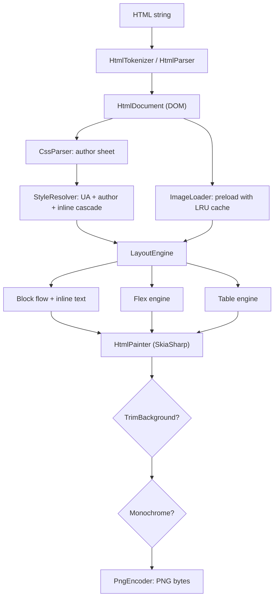

# HtmlToImageRenderer

A lightweight HTML5 + CSS renderer for .NET that rasterizes markup into PNG bytes or an `SKBitmap`
without a browser engine. Parsing, styling, layout and painting are implemented in this repository
on top of [SkiaSharp](https://github.com/mono/SkiaSharp), with SVG support from `Svg.Skia`.

- Own HTML tokenizer, parser and DOM (`Parsing\`)
- Own CSS parser, cascade and specificity handling (`Css\`)
- Block, inline, flex and table layout engines (`Layout\`)
- Raster images and vector SVG, data URIs, remote and local files (`Resources\`)
- Skia painting, PNG encoding, optional background trim and monochrome output (`Rendering\`)
- Caches that live on the renderer instance: fonts, parsed user-agent stylesheet, LRU image cache

Targets `net10.0` and depends on `SkiaSharp 4.156.0` and `Svg.Skia 5.2.3`.

## Installation

The library is not published on NuGet. Clone the repository and reference the project directly:

```xml
<ItemGroup>
  <ProjectReference Include="..\HtmlToImageRenderer\HtmlToImageRenderer\HtmlToImageRenderer.csproj" />
  <PackageReference Include="SkiaSharp" Version="4.156.0" />
  <PackageReference Include="Svg.Skia" Version="5.2.3" />
</ItemGroup>
```

## Quick start

```csharp
using HtmlToImageRenderer;
using SkiaSharp;

using var renderer = new HtmlRenderer(new HtmlRendererOptions
{
    Width = 800,
    DeviceScaleFactor = 2f,
    BackgroundColor = SKColors.White,
    BaseUri = "https://example.com/",
    TrimBackground = true,
});

string html = "<div style=\"display:flex;justify-content:space-between\">" +
              "<span>Total</span><b>40.75</b></div>";

// PNG bytes
byte[] png = renderer.RenderToPng(html);

// Asynchronously, with cancellation of image downloads
byte[] pngAsync = await renderer.RenderToPngAsync(html, cancellationToken);

// Bitmap; the caller owns and disposes it
using SKBitmap bitmap = renderer.RenderToBitmap(html);

// Composite into an existing canvas (no trim, no monochrome - the canvas is yours)
using var target = new SKBitmap(800, 600);
using var canvas = new SKCanvas(target);
renderer.Render(html, canvas);
```

Invalid or `null` markup raises `HtmlRenderException`; cancellation raises `OperationCanceledException`.
The renderer implements `IDisposable` and releases its caches on `Dispose`.

## Options

| Property | Type | Default | Description |
| --- | --- | --- | --- |
| `Width` | `int` | `1024` | Layout viewport width in CSS pixels. |
| `Height` | `int?` | `null` | Fixed output height; `null` computes it from the content. |
| `MaxAutoHeight` | `int` | `20000` | Upper bound for the auto-computed height. |
| `DeviceScaleFactor` | `float` | `1f` | Raster scale; layout stays in CSS pixels. |
| `BackgroundColor` | `SKColor` | `SKColors.White` | Canvas clear colour and the reference colour for `TrimBackground`. |
| `BaseUri` | `string?` | `null` | Base for relative image and file paths. |
| `DefaultFontFamily` | `string` | `"Segoe UI"` | Root font family; changing it recreates the font cache. |
| `DefaultFontSize` | `float` | `16f` | Root font size in pixels. |
| `DefaultLineHeight` | `float` | `1.2f` | Root line-height multiplier. |
| `LoadRemoteImages` | `bool` | `true` | Allow `http`/`https` image downloads. |
| `ImageLoadTimeout` | `TimeSpan` | `15s` | Per-request download timeout. |
| `ImageCacheSize` | `int` | `64` | Maximum cached images (LRU); `<= 0` disables image caching. |
| `TrimBackground` | `bool` | `false` | Crop the result to the bounding box of non-background pixels. |
| `Monochrome` | `bool` | `false` | Emit an 8-bit grayscale PNG with a fixed 50% threshold. |

## What is supported

### HTML

Elements, attributes, comments, void elements, implicit closes for `p` and `li`, raw-text
`style`/`script`/`textarea`/`title`, and HTML entities (named and numeric).

### CSS

Type, class and id selectors with descendant and `>` child combinators, specificity ordering,
`<style>` blocks and inline `style` attributes, inherited text properties. Lengths accept `px`, `%`,
`em`, `rem` and `pt`.

`display` values: `block`, `inline`, `inline-block`, `flex`, `table`, `table-row`, `table-cell`,
`table-row-group`, `table-caption`, `none`.

### Layout

- **Block**: content-box and border-box sizing, `width`/`height`, `min`/`max` constraints, auto
  margins, `auto` width filling the containing block.
- **Inline**: line breaking, white-space collapsing, per-line alignment, baseline-aligned images.
- **Flex**: `flex-direction` (row/column, both reverse directions), `flex-grow`, `flex-shrink`,
  `flex-basis`, `justify-content` (all six values), `align-items`, `gap`. Every child element is its
  own flex item; runs of text nodes become anonymous items.
- **Table**: automatic column layout from max-content widths, proportional scaling to the table
  width, `colspan`, `caption`, `thead`/`tbody`/`tfoot`, per-side borders on rows and cells.

### Text

`font-family`, `font-size`, `font-weight`, `font-style`, `color`, `text-align`,
`text-decoration: underline`, `line-height`, `white-space` handling and line wrapping.

### Borders and radii

Per-side width, style and colour (`solid`, `dashed`, `dotted`; `double`/`groove`/`ridge` fall back to
solid). `border-radius` accepts one to four values, percentages and the elliptical `/` syntax, and
clips box content to the rounded padding box.

### Images and SVG

PNG, JPEG, GIF, BMP, WEBP and ICO are decoded by SkiaSharp; SVG is parsed by `Svg.Skia` and drawn as
vector output at the final size, so it stays sharp at any `DeviceScaleFactor`. Sources may be data
URIs (whitespace inside the payload is tolerated), `http`/`https` URLs, `file` paths, absolute paths
or paths relative to `BaseUri`. `width`/`height` attributes are honoured and the missing side follows
the intrinsic aspect ratio.

### Presentational attributes

`align` on `table` (content-sized box placed left, centre or right), and `align` on `td`, `tr`, `th`
(maps to `text-align`, inherited from the row to its cells). Both sit below CSS in the cascade.

### Caching

Per renderer instance: one font resolver reused across renders (recreated when `DefaultFontFamily`
changes), the user-agent stylesheet parsed once per process, and an LRU image cache sized by
`ImageCacheSize`. Cached images are reference counted, so an eviction never disposes an image that an
in-progress render is still painting.

### Post-processing

- `TrimBackground` crops the bitmap to the bounding box of pixels that differ from `BackgroundColor`.
- `Monochrome` converts the colour bitmap to `Gray_8` using a fixed threshold on BT.601 luminance:
  `Y = 0.299R + 0.587G + 0.114B`, black when `Y < 128`, white otherwise.

## Limitations

- Vertical margins do not collapse.
- `flex-wrap: wrap` behaves as `nowrap`.
- No `float`, `position`, `opacity`, `box-shadow` or `background-image`.
- No `border-collapse`/`border-spacing`: adjacent cell borders overlap and read as a 2px line.
- No `rowspan`, no `col`/`colgroup`, no per-cell `vertical-align`.
- `@media` and `<link rel="stylesheet">` are ignored; unsupported at-rules are skipped.
- Inline `<svg>` markup is not rendered; only `` is.
- No `overflow` clipping; unbreakable strings overflow instead of breaking.
- With a non-zero `border-radius`, dashed and dotted borders are painted solid, and a corner arc
  shared by two sides takes the colour of the side painted last.
- `Monochrome` produces 8-bit grayscale, not a bit-depth-1 PNG, and does not dither; `RenderToBitmap`
  is unaffected by it.
- `TrimBackground` compares colours exactly, without tolerance.
- Concurrent renders on one renderer while mutating its `Options` are not supported.

## How it works



## Repository layout

| Path | Responsibility |
| --- | --- |
| `HtmlRenderer.cs` | Public facade: render methods, rasterization, caching ownership. |
| `HtmlRendererOptions.cs` | Rendering options and `Clone()`. |
| `HtmlRenderException.cs` | Exception raised for invalid input or rendering failures. |
| `Parsing\` | Tokenizer, parser, DOM nodes, entity decoding. |
| `Css\` | CSS parser, selectors, cascade, computed styles, user-agent stylesheet. |
| `Layout\` | Box model, block/inline/flex/table engines, font resolver, image sizing. |
| `Resources\` | Image loading, SVG and raster decoding, `HtmlImage`, LRU `ImageCache`. |
| `Rendering\` | Skia painter, background trimmer, monochrome converter, PNG encoder, render cache. |
| `HtmlToImageRendererTest\` | Sample console app exercising the renderer. |

## Building

```bash
dotnet build HtmlToImageRenderer.slnx
```

The sample app in `HtmlToImageRendererTest` renders several documents and writes PNG files, which is
the quickest way to check behaviour after a change.
